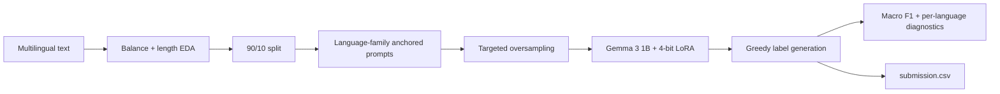

# Multilingual Sentiment Analysis with Gemma and QLoRA

A binary sentiment-classification experiment for the [NPPE DLP 2026 Term 1 Kaggle competition](https://www.kaggle.com/competitions/nppe-dlp-2026-term-1). The project adapts `google/gemma-3-1b-it` to classify short text as **Positive** or **Negative** across 13 Indian languages.

## Project at a glance

- Explores class balance, language balance, and sentence length before training.
- Loads Gemma in 4-bit NF4 and applies LoRA adapters to attention and MLP projection layers.
- Uses language-family prompt anchors and targeted oversampling for lower-resource language groups.
- Trains with gradient accumulation, checkpointing, FP16, and paged 8-bit AdamW.
- Reports overall and per-language macro F1 and generates a Kaggle-ready `submission.csv`.

## Languages

| Code | Language | Code | Language |
|---|---|---|---|
| `as` | Assamese | `bd` | Bodo |
| `bn` | Bengali | `gu` | Gujarati |
| `hi` | Hindi | `kn` | Kannada |
| `ml` | Malayalam | `mr` | Marathi |
| `or` | Odia | `pa` | Punjabi |
| `ta` | Tamil | `te` | Telugu |
| `ur` | Urdu |  |  |

## Pipeline



## Recorded notebook result

The executed notebook prints a **local macro F1 of 0.9778** on 90 validation examples, with 900 original labelled examples in total.

This number is useful as an experiment trace, **not as a clean held-out benchmark**. Although the notebook creates a 90/10 split, the later amplification and training cells use `train_full` rather than only `train_df`; prompt anchors also come from the full data. Validation rows can therefore influence training. A rigorous rerun should build augmentation and anchors from `train_df` only before reporting a generalization score.

## Reproduce on Kaggle

1. Join the competition and create a GPU notebook.
2. Attach the `nppe-dlp-2026-term-1` competition dataset.
3. Add a Hugging Face token as the `HF_TOKEN` Kaggle secret. The token must be allowed to access `google/gemma-3-1b-it`.
4. Import [`23f2003511.ipynb`](23f2003511.ipynb).
5. Run all cells and download `submission.csv` from the notebook output.

The notebook expects:

```text
/kaggle/input/competitions/nppe-dlp-2026-term-1/
├── train.csv
└── test.csv
```

It installs `transformers`, `peft`, `accelerate`, `bitsandbytes`, `datasets`, and `huggingface_hub` in the notebook. A CUDA GPU is required by the committed configuration (`device_map="cuda:0"`, FP16, and 4-bit bitsandbytes).

## Training configuration preserved in the notebook

| Setting | Value |
|---|---:|
| Base model | `google/gemma-3-1b-it` |
| Quantization | 4-bit NF4 with double quantization |
| LoRA rank / alpha | 128 / 256 |
| Max token length | 256 |
| Epochs | 3 |
| Per-device batch size | 4 |
| Gradient accumulation | 4 |
| Learning rate | `1e-4` |
| Scheduler | Cosine with 10% warmup |

The recorded model summary reports 708,345,856 trainable parameters (41.47% of all parameters), largely because `embed_tokens` and `lm_head` are also saved/trainable. This is substantially heavier than a minimal LoRA setup and should be considered when sizing GPU memory.

## Repository contents

```text
.
├── 23f2003511.ipynb   # EDA, QLoRA training, evaluation, inference
└── README.md
```

## Limitations

- The recorded validation F1 is affected by data leakage as described above and should not be used as a portfolio benchmark without a corrected rerun.
- Several languages have very small validation groups (as few as three examples), making per-language F1 unstable.
- The model is generative but evaluated as a binary classifier; any output other than one containing `Positive` is mapped to the negative class.
- Reproduction requires gated model access, the private competition data, and a capable CUDA GPU.
- No standalone checkpoint, requirements file, or application screenshot is committed; this repository is a notebook experiment.
